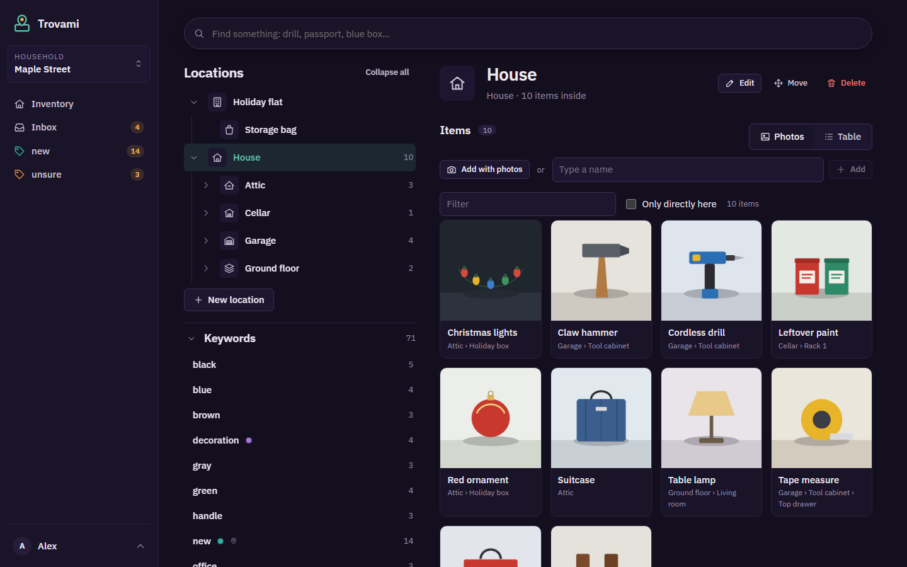
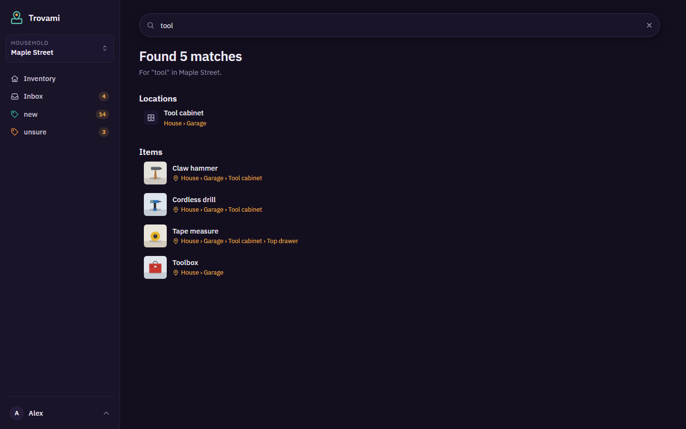
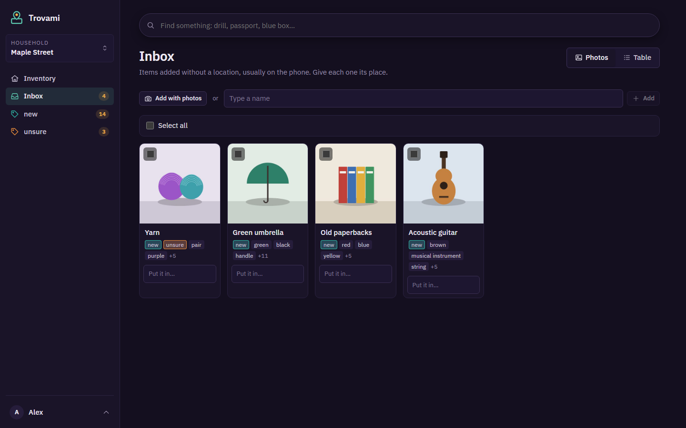
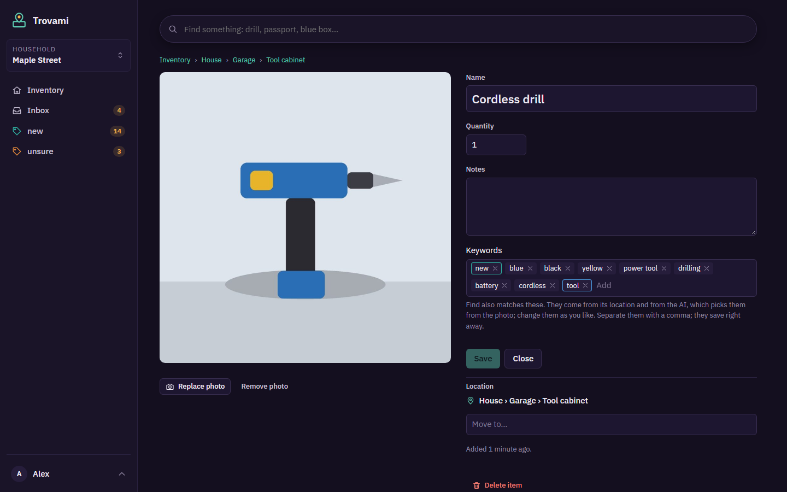
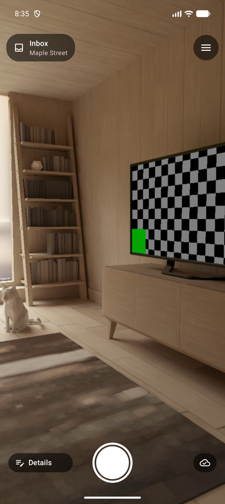
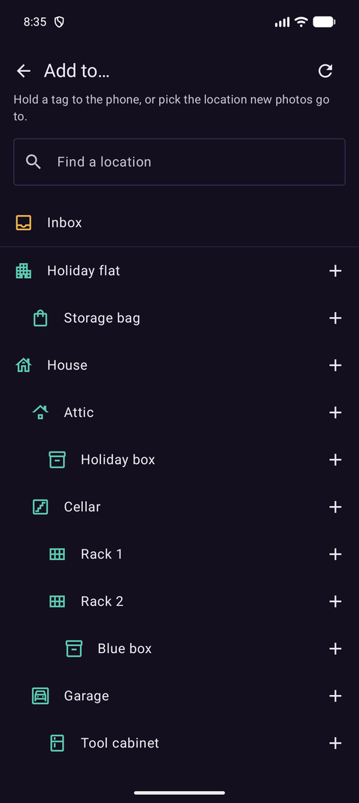

# Trovami

*Trovami* ("find me") remembers where your things are stored. Locations form a tree (House › Cellar › Rack 2 › Blue box), items sit at a location with a photo, and one search finds anything with its full path. Households are shared with the people you live with.



## What it does

- **Locations of any depth.** House → Floor → Room → Closet → Drawer, each with an icon, and optional notes, photo, color, short label and keywords.
- **Find.** One search over item names, notes, keywords, location names and labels, at the top of every page.
- **Android app for adding fast.** Scan an NFC tag or QR label, take a photo, done. It works offline in the cellar and syncs later. Without a tag, items land in the Inbox.
- **Inbox.** Give each new item its place from the web app, several at once if you like.
- **Keywords.** Words Find also matches, from you, the AI or the location. Typing suggests the ones you already use, each can have a color, and pinned ones stay in the menu. New items get "new", and the AI marks what it isn't sure of with "unsure".
- **AI naming.** An item added with just a photo gets its name and keywords from Claude or ChatGPT, using the household's own key. It's optional, and a name you typed is never overwritten.
- **Tags.** Link NFC tags on the phone, or print QR labels from the web app, including Dymo labels.
- **Households.** Invite people by email. Everyone in a household sees and edits everything in it.
- **Backups.** Daily automatic backups with photos included, a download with an optional password, and restore from the admin pages.

| Find | Inbox | Item |
| --- | --- | --- |
|  |  |  |

| Camera | Choosing a location |
| --- | --- |
|  |  |

All names and pictures here are invented demo data.

## Run it

```yaml
services:
  trovami:
    image: ghcr.io/geeforceone/trovami:latest
    ports:
      - "8337:8080"
    volumes:
      - trovami-data:/data
    restart: unless-stopped

volumes:
  trovami-data:
```

Open http://localhost:8337. The first person to open the app creates the admin account; there's no open sign-up after that. Everything (database, photos, keys, backups) lives in the `/data` volume. Keep the restart policy: a restore from the admin pages restarts the app and relies on it to come back.

Set up email under Admin settings to send invites and password resets.

### Settings

All optional, as environment variables.

| Variable | Default | What it sets |
| --- | --- | --- |
| `Storage__DataDirectory` | `/data` | Where everything persistent lives |
| `Storage__DatabasePath` | under the data directory | The SQLite database |
| `Storage__KeysPath` | under the data directory | Data Protection keys |
| `Storage__BackupsPath` | under the data directory | Automatic backups |
| `Storage__PhotosPath` | under the data directory | Item and location photos |
| `Trovami__ReleasesRepository` | `geeForceOne/Trovami` | The GitHub repository the app's update check reads |

## The Android app

Needs Android 10 or newer. Download the APK from the [latest release](https://github.com/geeForceOne/Trovami/releases/latest) and open it on the phone; Android asks you to allow installing from that source once. The app isn't on the Play Store. It checks for new releases itself and offers the update.

To sign in, open Profile → **Connect a phone** in the web app and scan the code, or enter the server address, email and password. Profile lists connected devices and can revoke them.

## Homepage widget

Trovami can show item, location and Inbox counts on [gethomepage.dev](https://gethomepage.dev). Create a token in Profile, which also shows the widget's configuration.

## Develop

```
dotnet run --project src/Trovami.Web     # http://localhost:5337, data in ./data
dotnet test tests/Trovami.Tests
cd android && ./gradlew assembleDebug    # the Android app
```

A `vX.Y.Z` tag publishes the image to `ghcr.io/geeforceone/trovami` and creates the GitHub release with the signed APK.

## License

MIT
